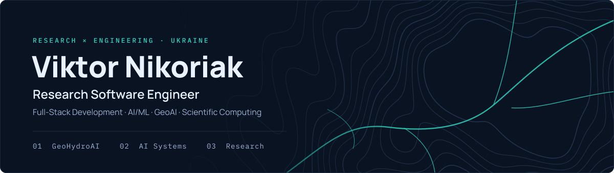
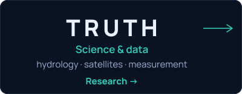
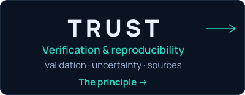
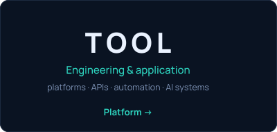
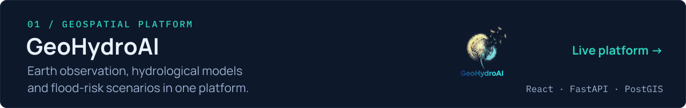
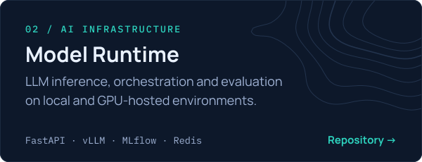
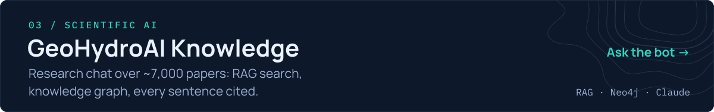
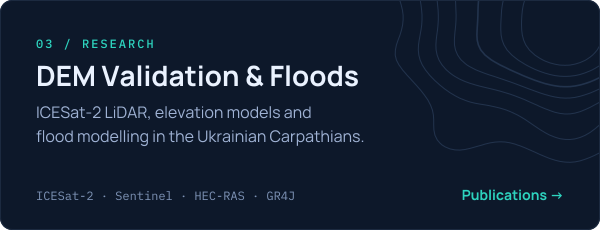
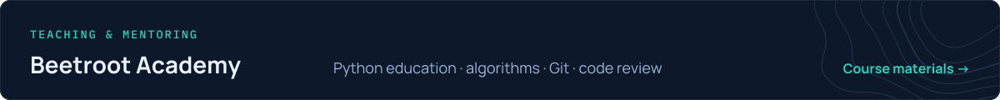

I build end-to-end scientific and AI systems — from field measurements and mathematical models to APIs, web platforms and cloud deployment. Founder of **[GeoHydroAI](https://geohydroai.org/)**, hydrologist and PhD researcher, Python instructor at **Beetroot Academy**. [More about me →](https://geohydroai.org/about/viktor-nikoriak)

<a href="https://geohydroai.org/about/viktor-nikoriak#principle"><em>From physical evidence to verified knowledge and practical tools.</em></a>

## Selected engineering & research

- **[GeoHydroAI](https://geohydroai.org/)** — bilingual flood platform for Ukrainian river basins: public flood map, HAND screening, GR4J/GR4H runoff runs, evidence-cited knowledge bot.
- **[Model Runtime](https://github.com/NikoriakViktot/model-runtime)** — self-hosted control layer for open-weight LLMs: on-demand vLLM / llama.cpp, one OpenAI-compatible gateway, 338 tests.
- **[Knowledge Graph](https://github.com/NikoriakViktot/geohydroai-knowledge-graph)** — research PDFs → Neo4j citation graph + vector index; ~987k chunks, 57k nodes (June 2026 snapshot).
- **[DEM & Floods](./pages/research.md)** — where global elevation models fail and how that changes flood maps.
- **[Teaching](./pages/teaching.md)** — 52-lesson Python course with PR-based code review · [course book](https://nikoriakviktot.github.io/PY-Course-Victor-Nikoriak-22-09-2026/).

**[Engineering](./pages/engineering.md)** · **[Research](./pages/research.md)** · **[Teaching](./pages/teaching.md)**

## Publications

**Validation of global elevation models using ICESat-2 LiDAR data for floodplain modeling in the Ukrainian Carpathians** 
Geophysical Journal · 2026 · [doi:10.24028/gj.v48i2.346831](https://doi.org/10.24028/gj.v48i2.346831)

**A High-Resolution Hydrological Dataset for Ukrainian River Basins With an Interactive Web Interface** 
Geoscience Data Journal · 2025 · [doi:10.1002/gdj3.70027](https://doi.org/10.1002/gdj3.70027)

All publications: [Google Scholar](https://scholar.google.com/citations?user=oPSQ_5wAAAAJ) · [ORCID](https://orcid.org/0009-0007-9934-4151) · [Research overview](https://geohydroai.org/about/viktor-nikoriak#research)

PhD research at the Ukrainian Hydrometeorological Institute, supported by the German Federal Environmental Foundation (DBU) with the Bavarian Environment Agency (LfU) as partner.

## Stack

`Python` · `R` · `JavaScript` · `TypeScript` · `React` · `FastAPI` · `Django` · `PostgreSQL/PostGIS` · `Docker` · `AI/ML` · `GeoAI`

**[geohydroai.org](https://geohydroai.org/)** · **[About](https://geohydroai.org/about/viktor-nikoriak)** · **[Google Scholar](https://scholar.google.com/citations?user=oPSQ_5wAAAAJ)** · **[LinkedIn](https://www.linkedin.com/in/viktor-nikoriak-328404203/)** · **[ORCID](https://orcid.org/0009-0007-9934-4151)**

