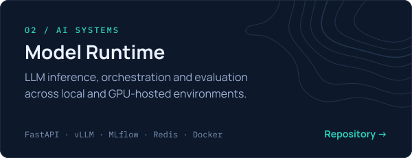

<!-- 01 — Identity -->

I build end-to-end scientific and AI systems — from field measurements and mathematical models to APIs, web platforms and cloud deployment. Founder of **[GeoHydroAI](https://geohydroai.org/)**, hydrologist and PhD researcher, Python instructor at **Beetroot Academy**. [More about me →](https://geohydroai.org/about/viktor-nikoriak)

<!-- 02 — Philosophy -->

<a href="https://geohydroai.org/about/viktor-nikoriak#principle"><em>From physical evidence to verified knowledge and practical tools.</em></a>

## Selected work

<!-- 03 — Selected Engineering -->

Also: **[GeoHydroAI Knowledge Graph](https://github.com/NikoriakViktot/geohydroai-knowledge-graph)** — scientific literature parsing, embeddings, citation graphs and evidence-grounded answers (`GROBID` `ChromaDB` `Neo4j` `DuckDB`).

**[Engineering](./pages/engineering.md)** · **[Research](./pages/research.md)** · **[Teaching](./pages/teaching.md)**

## Research & teaching

<!-- 04 — Research & Teaching -->
- **Nikoriak, V. V., Osypov, V. V., & Osadcha, N. M. (2026).** *Validation of global elevation models using ICESat-2 LiDAR data for floodplain modeling in the Ukrainian Carpathians.* [doi:10.24028/gj.v48i2.346831](https://doi.org/10.24028/gj.v48i2.346831)
- *A High-Resolution Hydrological Dataset for Ukrainian River Basins With an Interactive Web Interface* (2025), **Geoscience Data Journal**. [doi:10.1002/gdj3.70027](https://doi.org/10.1002/gdj3.70027)
- PhD research at the Ukrainian Hydrometeorological Institute; project supported by the **German Federal Environmental Foundation (DBU)** with the **Bavarian Environment Agency (LfU)** as partner.
- All publications: [Google Scholar](https://scholar.google.com/citations?user=oPSQ_5wAAAAJ) · [ORCID](https://orcid.org/0009-0007-9934-4151) · [research overview](https://geohydroai.org/about/viktor-nikoriak#research)
- Teaching Python at **Beetroot Academy** — [course materials](https://github.com/NikoriakViktot/PY-Course-Victor-Nikoriak-22-09-2026).

## Stack

<!-- 05 — Technical Stack & Contact -->
| | |
| :--- | :--- |
| **Languages** | Python · TypeScript · JavaScript · SQL · R |
| **Product** | React · FastAPI · Django · Dash · Deck.gl |
| **Data** | PostgreSQL/PostGIS · DuckDB · Redis · GeoParquet · ETL |
| **AI / ML** | RAG · vLLM · LiteLLM · MLflow · ChromaDB · Neo4j · scikit-learn |
| **Geo & hydrology** | GDAL · Rasterio · GeoPandas · Earth Engine · Sentinel-1/2 · ICESat-2 · HEC-RAS · GR4J |
| **Infrastructure** | Docker · Linux · Nginx · GitHub Actions · AWS |

**[geohydroai.org](https://geohydroai.org/)** · **[About](https://geohydroai.org/about/viktor-nikoriak)** · **[Google Scholar](https://scholar.google.com/citations?user=oPSQ_5wAAAAJ)** · **[LinkedIn](https://www.linkedin.com/in/viktor-nikoriak-328404203/)** · **[ORCID](https://orcid.org/0009-0007-9934-4151)**

