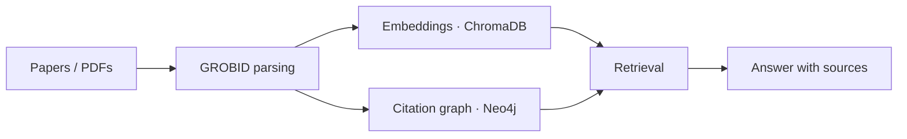

# Engineering

[← Back to profile](../README.md)

Software I design, build and run — usually from the data model to deployment.

## GeoHydroAI — geospatial research & decision-support platform

[geohydroai.org](https://geohydroai.org/)

A full-stack platform that brings satellite imagery, DEM validation, hydrological forecasting, interactive maps and flood-risk scenarios into one web interface.

- **Frontend:** React, TypeScript, Deck.gl, MapLibre
- **Backend:** FastAPI, Django, PostgreSQL/PostGIS
- **Delivery:** Docker, Nginx, Linux

## Model Runtime — LLM inference & orchestration

[github.com/NikoriakViktot/model-runtime](https://github.com/NikoriakViktot/model-runtime)

Manages model execution, inference endpoints, experiment tracking and evaluation across local and GPU-hosted environments.

`Python` `FastAPI` `Docker` `PostgreSQL` `Redis` `vLLM` `MLflow`

## GeoHydroAI Knowledge Graph — scientific knowledge infrastructure

[github.com/NikoriakViktot/geohydroai-knowledge-graph](https://github.com/NikoriakViktot/geohydroai-knowledge-graph)

Parses scientific literature, builds embeddings and citation relationships, and serves evidence-grounded answers with sources.

`Python` `GROBID` `ChromaDB` `Neo4j` `DuckDB` `RAG`
