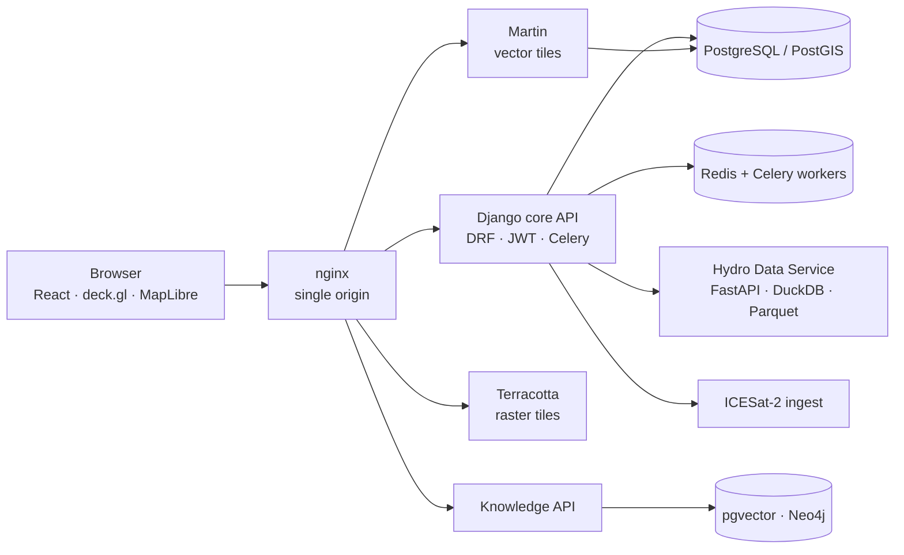
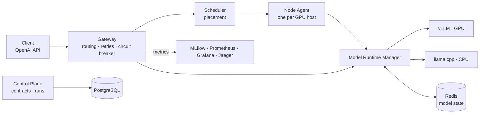
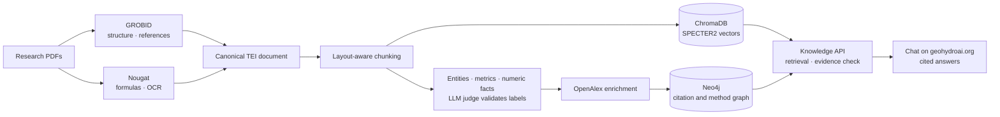

[← Back to profile](../README.md) · [Research](./research.md) · [Teaching](./teaching.md)

**On this page:** [GeoHydroAI](#01--geohydroai--geospatial-platform) · [Model Runtime](#02--model-runtime--ai-infrastructure) · [GeoHydroAI Knowledge](#03--geohydroai-knowledge--scientific-ai)

---

## 01 / GeoHydroAI — geospatial platform

**[geohydroai.org](https://geohydroai.org/)** · bilingual (EN/UA) · in production

A flood platform for Ukrainian river basins: hazard screening, hydrological modelling, risk assessment, resilience planning and evidence validation. It is built on FABDEM terrain checked against ICESat-2 and on HAND screening. HEC-RAS hydraulic runs are being integrated.

**What users get**

- **[Public flood map](https://geohydroai.org/flood-map)** with no sign-in: HAND screening mask, official flood-risk maps, and the status of HEC-RAS modelling on priority reaches.
- **Five workspace modes:** screening, hazard, risk, resilience and evidence. Projects have roles, saved pages and scenario share links.
- **Rainfall–runoff runs** with CemaNeige-GR4J (daily) and GR4H (hourly) via airGR.
- **A knowledge bot that answers only from the research base.** Every sentence cites evidence, unsupported sentences are removed, and numbers and DOIs are protected so the model cannot alter them.
- **Field reports** of flooding, sent from a phone.

**Architecture**

**Technical decisions**

| Decision | Why |
| :--- | :--- |
| One OpenAPI contract. Frontend types are generated from Django's schema, and mocks are tested against it. | Frontend and backend can't drift. A test fails as soon as a mocked endpoint becomes real, so the mock gets removed. |
| Permissions are computed once on the server and sent as a DTO. | Otherwise the UI shows actions the server will reject. |
| One writer per fact, plus a guarded job state machine. | Job status can't diverge between services. |
| Django never stores observations; it caches gauge cards. | The hydro service stays the data of record. If it is down, reads return `available: false` instead of failing. |
| Optimistic concurrency on pages (ETag / If-Match → 409). | Two people editing one page can't overwrite each other. |
| Versioned, immutable tiles; pre-simplified geometry at small scales. | Network time dominated. Caching and simplification cut it the most. |
| Integrate validated models (airGR, HEC-RAS, WhiteboxTools), don't re-implement physics. Heavy compute runs as isolated Docker jobs. | Scientific credibility on a small shared server, without heavy jobs slowing the API. |
| National DEM-error map on H3 hexagons, precomputed. | Fast country-wide view of DEM vs ICESat-2 error. |

**Results**

- **Data behind the platform:**
  - ≈600 gauging posts with daily levels and discharge for 1921–2025 (about 9 M readings)
  - 234 meteorological stations
  - 221 official flood-risk areas, 188 of them along 8,748 km of rivers
- **Performance pass (Oct 2026):** CN raster from 480 ms cold to 6 ms cached; rating curve from 290 ms to 38 ms; soils tile at the smallest zoom from 124 KB to 34 KB.
- **Tests:**
  - Frontend: ≈520 unit tests and ≈136 Playwright end-to-end tests, plus a performance suite
  - Backend: ≈700 tests
- **Delivery:** release directories switched by symlink, 10 kept for instant rollback, smoke tests after every deploy, CI on self-hosted runners.

**Status, kept explicit on purpose:**

| Shipped | In development |
| :--- | :--- |
| Public flood map, HAND screening, official flood-risk maps | HEC-RAS runs served by the API (map time player is empty until then) |
| Projects, roles, saved pages, scenario sharing | Geoprocessing service |
| GR4J / GR4H runoff runs | Evacuation plans in the Response lab |
| ICESat-2 DEM-error hexagons, gauges | Design flow at ungauged outlets |

`React 19` `TypeScript` `deck.gl` `MapLibre` `Django 5` `DRF` `Celery` `PostGIS` `FastAPI` `DuckDB` `H3` `Docker` `nginx`

---

## 02 / Model Runtime — AI infrastructure

**[github.com/NikoriakViktor/model-runtime](https://github.com/NikoriakViktor/model-runtime)** · MIT · experimental

A self-hosted control layer for open-weight LLMs. It starts and stops models on demand, either vLLM on GPU or llama.cpp on CPU, and places them on GPUs. They are served through one OpenAI-compatible gateway, and training and evaluation runs are tracked as versioned contracts.

**Architecture**

**Technical decisions**

| Decision | Why |
| :--- | :--- |
| *"Control Plane decides. Runtime executes."* | Policy is separate from execution, so experiments stay auditable and reproducible. |
| *"Docker is a sensor. Redis is truth."* The manager reconciles the two. | Container state and intended state can drift; one source of truth fixes that. |
| Model states ABSENT → STARTING → READY → STOPPING, with `ensure` + `touch` and idle eviction. | GPUs are shared and models load on demand. |
| Backend fallback fp16 → AWQ → GGUF q8 → q4, chosen with a VRAM estimator. | A model still runs on smaller hardware, at lower precision. |
| One retry with jitter, only for 503/504; never for 429, never after a stream has started. | Respect backpressure; never send a client a duplicated stream. |
| Load shedding by latency and RAM; 503 (capacity) kept separate from 429 (queue). | Overload fails fast and clearly instead of timing out. |

**Results**

- **Services:** gateway, model manager, scheduler, node agent, CPU runtime, control plane, observability stack, Streamlit operator UI.
- **338 tests** across unit, integration, system, resilience, chaos and SLO suites. CI runs lint, then unit tests, then integration tests.
- **CPU-only "lite" stack** so the whole system runs without a GPU.

**Next:** sandboxed tool and network access, monitor models, red/blue-team evaluation, provenance tracking.

`Python` `FastAPI` `vLLM` `llama.cpp` `Redis` `PostgreSQL` `SQLAlchemy` `MLflow` `Prometheus` `Grafana` `OpenTelemetry` `Docker`

---

## 03 / GeoHydroAI Knowledge — scientific AI

**Chat on [geohydroai.org](https://geohydroai.org/flood-map)** · open to guests · source code private

A research chat about floods, hydrology, terrain and satellite data. It answers only from the GeoHydroAI knowledge base: about 7,000 research papers, the numbers from their tables, and a knowledge graph of methods, sensors and data. It does not use the internet or the model's general knowledge.

**How an answer is made**

1. **RAG search** finds the closest passages, figure captions and tables in the papers.
2. **The knowledge graph** adds related methods and numeric facts.
3. **A language model** (Claude, or another model chosen in the chat) writes the answer from this evidence only. It cannot change numbers or DOIs.
4. **The server checks every sentence.** A sentence with no link to the evidence, or with a number the evidence does not contain, is removed.

**What users get**

- **A citation on every sentence.** Clicking `[1]` shows the paper's title, year, page, the passage and its DOI. Under the answer: a list of sources and the answer's limitations.
- **Four answer styles:** plain language, scientific, practical, and critical review (what is established, where studies disagree, what the evidence does not say).
- **Explanations built into the map.** Each map layer and gauge card has an "Ask the bot" button that explains what the layer shows, how it is computed and where it stops being valid, with links to papers.
- **Sign-in and history.** Guests get 5 questions a day. Signed-in users get no daily limit, a default style and saved conversations.
- **"Report a mistake"** under every answer.
- **Honest gaps.** "No evidence found" means the base has no support for a claim, not that the claim is false. The bot does not forecast floods and does not replace official warnings.

**How it is built.** A pipeline turns research PDFs into structure, references, methods, sensors, study areas and numeric results from tables. These are loaded into a citation graph and a vector index.

**Architecture**

**Technical decisions**

| Decision | Why |
| :--- | :--- |
| SPECTER2 embeddings instead of a general model. | Trained on citation pairs, so scientific terms and numeric claims cluster sensibly. Worth 2× dimensions. |
| GROBID and Nougat merged into one immutable document. Nougat runs only when GROBID quality is low. | GROBID wins on structure and references, Nougat on formulas. The GPU is used only where needed. |
| Ray actors with fractional GPUs. | Models load once per worker, several models share one card, and backpressure comes built in. |
| Embedded ChromaDB, with a stated move to Qdrant above ~5 M chunks. | Simple, persistent, filterable; the scaling limit is known in advance. |
| Neo4j writes only through `MERGE`. | Re-running the pipeline is safe: no accidental deletes, no duplicates. |

**Pipeline results** (corpus snapshot of 9 June 2026, from the project's audit docs; the base has grown since)

- ≈3,900 PDFs parsed; **986,832 chunks** indexed from about 3,700 papers.
- **57,603 graph nodes** and **92,003 citation edges**.
- **16,308 numeric facts** extracted from 667 papers.
- A domain knowledge base of 1,118 entities with 3,161 aliases.
- **600+ tests** that run without a GPU, Ollama or Ray.

**Lessons recorded in the audit:**

- A 768- vs 384-dimension mismatch silently left 3,546 papers unindexed. It was found and fixed by rebuilding the index.
- Methods-section detection and RMSE/NSE coverage are the next weak spots to fix.

**Next:** figure retrieval, equation search, citation-intent classification, a tool-using research agent.

`Python` `GROBID` `Nougat` `Ray` `spaCy` `SPECTER2` `ChromaDB` `Neo4j` `DuckDB` `OpenAlex` `Ollama` `Dash`

---

[← Back to profile](../README.md)
