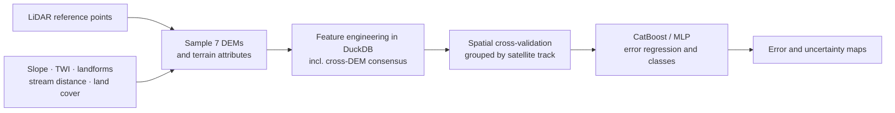
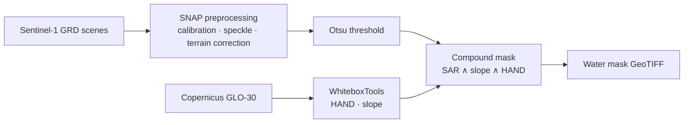

[← Back to profile](../README.md) · [Engineering](./engineering.md) · [Teaching](./teaching.md)

I study how accurately floods can be mapped and modelled in mountain catchments where ground data is scarce. Satellite LiDAR and radar fill the gaps. Most of my work is in the Ukrainian Carpathians and Bukovyna, as part of my PhD at the Ukrainian Hydrometeorological Institute. The research is supported by the **German Federal Environmental Foundation (DBU)**, with the **Bavarian Environment Agency (LfU)** as project partner.

**Profiles:** [Google Scholar](https://scholar.google.com/citations?user=oPSQ_5wAAAAJ) · [ORCID](https://orcid.org/0009-0007-9934-4151) · [Research on geohydroai.org](https://geohydroai.org/about/viktor-nikoriak#research)

---

## Publications

**Validation of global elevation models using ICESat-2 LiDAR data for floodplain modeling in the Ukrainian Carpathians** 
Nikoriak, V. V., Osypov, V. V., & Osadcha, N. M. · Geophysical Journal · 2026 · [doi:10.24028/gj.v48i2.346831](https://doi.org/10.24028/gj.v48i2.346831)

**A High-Resolution Hydrological Dataset for Ukrainian River Basins With an Interactive Web Interface** 
Geoscience Data Journal · 2025 · [doi:10.1002/gdj3.70027](https://doi.org/10.1002/gdj3.70027)

---

## Research lines

### DEM error — where global elevation models fail, and why

Seven global DEMs are compared against satellite LiDAR reference heights: ALOS, ASTER, Copernicus, FABDEM, NASADEM, SRTM and TanDEM-X. The error is then modelled from terrain, hydrology and land cover. The goal is to know, before modelling a floodplain, where the terrain can be trusted.

**Results so far** (FABDEM error, 5-fold spatial cross-validation, about 2 M points):

- **Regression:** RMSE 3.64 ± 0.32 m, MAE 2.51 ± 0.26 m, **R² 0.66 ± 0.04**. Cross-DEM consensus features improved R² from 0.62.
- **Error classes** (low / mid / high): macro-F1 0.51. High-error zones are the easiest class to detect (F1 0.64).
- Validation is grouped by satellite track, so each test fold comes from tracks the model never saw in training.

*Work in progress, not yet published.*

### Flood extent from Sentinel-1 radar

Water is mapped from SAR backscatter and kept only where it is physically plausible:

> backscatter below the Otsu threshold **and** slope < 8° **and** height above nearest drainage (HAND) < 25 m

The test case is the **June 2020 flood in Bukovyna**: 6 Sentinel-1 scenes from 11–13 June over a 1,570 km² basin.

Engineered as a service rather than a notebook: 6 Docker services, Redis job queues, HAND cached per basin, and 290+ tests.

### Hydrological and hydraulic modelling

- Rainfall–runoff: CemaNeige-GR4J / GR4H (airGR)
- Hydraulics: HEC-RAS
- Screening with HAND

All three run inside [GeoHydroAI](./engineering.md#01--geohydroai--geospatial-platform) on records from ≈600 gauging posts covering 1921–2025.

---

## Methods & tools

| Area | Tools |
| :--- | :--- |
| Satellite data | ICESat-2, Sentinel-1/2, Google Earth Engine, Copernicus Data Space |
| Terrain | GDAL, Rasterio, xDEM, WhiteboxTools, QGIS |
| Hydrology | airGR (GR4J/GR4H), HEC-RAS, HEC-HMS, SWAT+ |
| Machine learning | CatBoost, PyTorch, scikit-learn, spatial cross-validation |
| Data | DuckDB, Parquet/GeoParquet, PostGIS |

[← Back to profile](../README.md)
