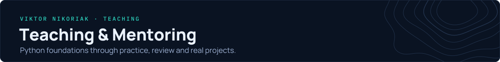
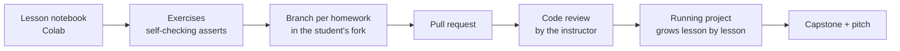

[← Back to profile](../README.md) · [Engineering](./engineering.md) · [Research](./research.md)

## Python Instructor — Beetroot Academy

I teach Python from first principles to production. Students write code every lesson, submit it as pull requests and get line-by-line review, the same way engineering teams work.

**[Open the course book →](https://nikoriakviktot.github.io/PY-Course-Victor-Nikoriak-22-09-2026/)** · source: [PY-Course-Victor-Nikoriak-22-09-2026](https://github.com/NikoriakViktor/PY-Course-Victor-Nikoriak-22-09-2026) — the autumn 2026 cohort

---

## Course structure

52 lessons in six modules, published as a course book on GitHub Pages, with notebooks that run in Colab.

| Module | Lessons | Topics |
| :--- | :---: | :--- |
| **1 · Python Core** | 17 | Data types and control flow, collections, functions, decorators, generators, exceptions, files and JSON, Git/GitHub, Big-O and search practicums |
| **2 · Python Advanced** | 11 | OOP, recursion, dunder methods, pytest, dynamic programming and greedy algorithms, concurrency, data structures |
| **3 · Databases** | 2 | SQL, Redis |
| **4 · Web** | 17 | HTTP and REST, Django, DRF and FastAPI, Pydantic, SQLAlchemy, auth, API testing, WebSocket, security, LLM APIs and AI dev tools |
| **5 · Production** | 3 | Docker, Compose and deployment, CI/CD |
| **6 · Capstone** | 2 | Final project and graduation pitch |

## How the course works

- **Git from week one.** Every homework is a branch and a pull request, reviewed like production code.
- **One project that grows.** A news-portal backend (`news_hub`) is extended over the last 15 web lessons, with its own pytest suite in CI.
- **Self-checking exercises.** Asserts inside the notebooks give instant feedback before review.
- **Course infrastructure is code too:**
  - A generator builds student notebooks from instructor notebooks by stripping solutions.
  - A sync tool keeps Colab badges and metadata current.
  - 4 GitHub Actions workflows build the docs, check notebooks and run project tests.

## Numbers

- 52 lessons · 165 notebooks · 200+ test files in course projects
- Students' capstone themes include a book-catalogue web app, an HR analytics dashboard, an auction-monitoring bot and a sales dashboard.

## Interests

Python for GIS, satellite data analysis and applied GeoAI. These are the bridge between this course and my [research](./research.md).

[← Back to profile](../README.md)
